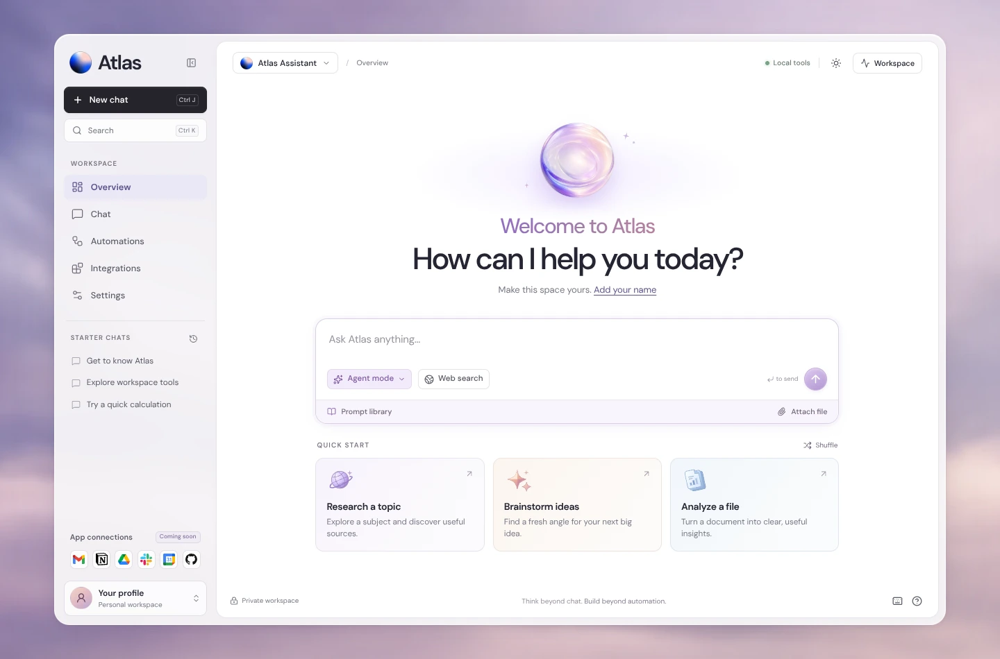

# Atlas 2.0

**One personal AI workspace for conversations, tools and repeatable tasks.**

Atlas combines a React interface with a FastAPI service, a bounded LangGraph agent and persistent SQLite history. New workspaces open with **Welcome to Atlas**. Choose **Add your name** to personalize the greeting for this workspace, or start chatting without a name. **Workspace** in the top bar shows real activity; an empty history shows clearly labeled starters, not invented conversations or runs.



## Try it

With **Python 3.12+** and **Node 22**, from the repository root:

```bash
python -m venv .venv
source .venv/bin/activate                 # Windows PowerShell: .\.venv\Scripts\Activate.ps1
python -m pip install -r requirements.txt
npm --prefix frontend ci
npm --prefix frontend run build
python -m uvicorn backend.app.main:app --host 127.0.0.1 --port 8000 --no-access-log
```

Open **http://127.0.0.1:8000**. Enter **`Calculate (48 + 12) * 3`** in the overview. Atlas will open a conversation, run the calculator, return **180** and save the exchange. No API key is needed for this path.

For open-ended AI conversations, go to **Settings → Agent & model → Configure key**. Groq credentials are verified server-side before persistence. Environment keys are also supported; their presence alone is not a successful live verification.

## What is available

| Workspace | Implemented behavior |
|---|---|
| **Overview** | Personalized welcome, multiline command-to-chat with attachments, suggested prompts and prompt library. Open **Workspace** for conversation counts, tool usage and recent workflow activity. |
| **Chat** | Groq token streaming and native tool calls when configured, deterministic local commands, a multicolor window edge only while answering (static with reduced motion), activity summaries, stop, regenerate, Markdown/code copying, bounded text attachments, reopen, Markdown export and deletion. |
| **Automations** | Create a named manual workflow with a description and explicit local tool. Run, pause, resume and inspect the last 20 results. No scheduling engine or arbitrary generated actions. |
| **Integrations** | Verify/configure Tavily and OpenWeather. Gmail, Notion, Drive, Slack, GitHub and Calendar have local brand icons and **Coming soon** details; they do not access accounts. |
| **Settings** | Profile, theme, model, response style, history context and external-tool preferences. Encrypted write-only credential storage. |

### Eight tool contracts

- **Date/time:** UTC clock. Try `What time is it?`
- **System information:** safe Atlas application metadata, not host inspection. Try `Show my workspace tools.`
- **Calculator:** bounded numeric AST interpreter; no Python evaluation.
- **File read/write:** private `.txt`, `.md`, `.csv` files. `Write note.txt: A useful idea` produces an exact, expiring approval request. After approval, `Read note.txt` reads it. No overwrite or arbitrary paths.
- **Restricted Python:** `Python: n = 6 * 7` followed by a newline and `print(n)`. A separate process interprets a tiny numeric subset, not general Python.
- **Weather:** `Weather in Srinagar` with OpenWeather configured.
- **Search:** `Search the web for Python documentation` with Tavily configured.

Attaching a text file does not silently create a workspace file. Without Groq, document inspection reports real word/line counts and a preview; it does not pretend to provide semantic analysis.

## Engineering notes

- [Original repository audit and rebuild plan](docs/audit.md)
- [Architecture, data model and streaming contract](docs/architecture.md)
- [Windows, development, Docker and Render setup](docs/setup.md)
- [Phase gates and test evidence](docs/verification.md)
- [Product roadmap and deferred work](docs/roadmap.md)
- [Security and disclosure](SECURITY.md) · [Asset credits](docs/credits.md)

```text
backend/app/   api/v1 · agent · core · database · integrations · services · tools
backend/tests/ unit, API, stream, persistence and opt-in provider checks
frontend/src/  layouts · pages · components/ui · contexts · services · styles
frontend/tests/ Playwright tests against a real FastAPI service
```

This milestone is a **single-process personal assistant**, not a multi-tenant SaaS. Production mode requires an owner gate. Use durable private storage, TLS and backups before hosting. The original alpha commit, license and historical media remain intact.

*Think beyond chat. Build beyond automation.*
